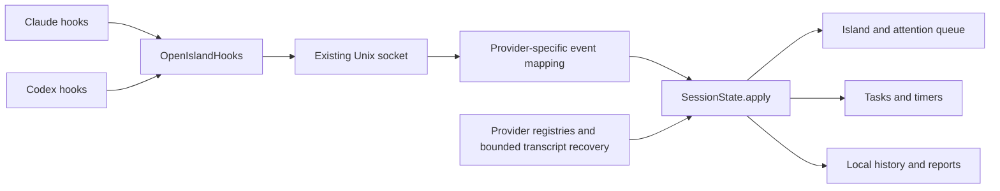

# Codex as the second monitored agent

Status: implemented as an opt-in CLI preview, 2026-10-22. Source baseline: local `main`, `de9571f`. The original design below records the investigation; the implementation/validation status at the end distinguishes shipped code from pending native-client acceptance.

Add Codex to the existing Focus Island session pipeline so Claude Code and Codex can share tasks, attention queues, timers, and history. Use a small Codex adapter behind the existing Unix socket bridge. Keep the application local and retain the `OpenIsland*` executable names.

The first release should monitor local Codex CLI sessions. Include local Codex desktop sessions only after their lifecycle and navigation checks pass independently. Approvals and answers stay in Codex. Full interaction parity, remote/cloud sessions, and a general agent-plugin framework are outside this first release.

## Functionality at the original baseline

| Area | Implemented behavior | Source |
| --- | --- | --- |
| macOS companion | SwiftUI/AppKit notch and top-bar surfaces, session groups, attention/completion cards, terminal navigation | [AppModel](../Sources/OpenIslandApp/AppModel.swift), [IslandSurface](../Sources/OpenIslandApp/IslandSurface.swift), [TerminalJumpService](../Sources/OpenIslandApp/TerminalJumpService.swift) |
| Live monitoring | Claude hooks feed a helper executable, NDJSON Unix socket, bridge server, and central session reducer | [Hook CLI](../Sources/OpenIslandHooks/OpenIslandHooksCLI.swift), [BridgeServer](../Sources/OpenIslandCore/BridgeServer.swift), [SessionState](../Sources/OpenIslandCore/SessionState.swift) |
| Recovery | Restore a recent Claude registry, discover JSONL transcripts, reconcile terminal attachments and processes | [Discovery coordinator](../Sources/OpenIslandApp/SessionDiscoveryCoordinator.swift), [Process monitoring](../Sources/OpenIslandApp/ProcessMonitoringCoordinator.swift) |
| Focus workflow | Bind multiple sessions to tasks, run pomodoros/breaks, surface waiting sessions, queue prompts, suggest next actions, detect distractions | [FocusCoordinator](../Sources/OpenIslandApp/Focus/FocusCoordinator.swift), [FocusCore](../Sources/FocusCore/) |
| Board and history | Kanban, task criteria, notes, session archive, resume/new-session commands | [BoardService](../Sources/FocusCore/BoardService.swift), [SessionHistory](../Sources/FocusCore/SessionHistory.swift), [ResumeCommand](../Sources/FocusCore/ResumeCommand.swift) |
| Reports | Local activity spans, daily/weekly totals, parallelism, waiting and distraction time | [ActivityLog](../Sources/FocusCore/ActivityLog.swift), [FocusLogs](../Sources/FocusCore/FocusLogs.swift) |
| Setup and storage | Install/uninstall Claude hooks with a manifest and backups; SQLite focus data and a bridge socket under Application Support/FocusIsland | [Claude installer](../Sources/OpenIslandCore/ClaudeHookInstallationManager.swift), [FocusStore](../Sources/FocusCore/FocusStore.swift), [BridgeTransport](../Sources/OpenIslandCore/BridgeTransport.swift) |
| Verification | Core, focus, and app tests; string lint; synthetic bridge/UI smoke scenarios; manual CI dispatch | [Package.swift](../Package.swift), [harness](../scripts/harness.sh), [CI](../.github/workflows/ci.yml) |

The package has five production targets (`OpenIslandApp`, `OpenIslandCore`, `FocusCore`, `OpenIslandHooks`, `OpenIslandSetup`) and three test targets. The four-target description in `CLAUDE.md` predates `FocusCore`.

The useful foundation is already present: `AgentSession` has a tool field, `AgentEvent` describes common transitions, `SessionState.apply(_:)` owns those transitions, and `AppModel` can group by agent. However, the only `AgentTool` case is `claudeCode`; this is not working multi-agent support yet.

## Changes required before Codex can work reliably

| Boundary | Current assumption and consequence | Required change |
| --- | --- | --- |
| Identity | In-memory state and persisted history use a bare session ID | Introduce provider-aware Codex IDs without renumbering existing Claude records |
| Metadata | Prompt, transcript, tool, and completion accessors read `claudeMetadata`; FocusCoordinator also reads it directly | Add Codex metadata and route shared consumers through common accessors |
| Ingress | Helper accepts only `--source claude`; bridge command is `processClaudeHook` | Add a separate Codex payload/command path and immediate acknowledgement |
| Liveness | Process discovery and matching only identify Claude; all hook-managed sessions can be ended after two missed polls | Partition reconciliation by provider and distinguish unknown liveness from confirmed exit |
| Restore | `ClaudeTrackedSessionRecord.session` always constructs `.claudeCode`; persistence filters out other tools | Persist/restore Codex separately and merge by provider plus native ID |
| History | `SessionRecord` and `SessionObservation` have no provider or native ID | Add an additive SQLite migration and preserve all existing task/session relationships |
| Actions | Resume/new-session commands always launch `claude`; permission/answer handlers optimistically resolve state | Dispatch launch by provider and enforce observation-only Codex actions at the handler boundary |
| Setup | Installation intent, diagnostics, auto-install, and onboarding only know Claude | Independent Codex connection state and an explicit Connect action |
| Reporting | Running spans use `ActivityKind.claude` and totals named `claudeSeconds` | Preserve old data and prevent Codex time being reported as Claude time |
| Presentation | Provider labels, task binding, summaries, plan steps, and settings contain Claude-specific paths | Audit shared screens and hide unsupported Codex details |

Relevant files include [AgentSession](../Sources/OpenIslandCore/AgentSession.swift), [AgentEvent](../Sources/OpenIslandCore/AgentEvent.swift), [ClaudeSessionRegistry](../Sources/OpenIslandCore/ClaudeSessionRegistry.swift), [FocusModels](../Sources/FocusCore/FocusModels.swift), [AgentSession presentation](../Sources/OpenIslandApp/AgentSession+Presentation.swift), and [HookInstallationCoordinator](../Sources/OpenIslandApp/HookInstallationCoordinator.swift).

Two traps deserve explicit tests. First, adding the enum case alone can produce sessions that disappear during reconciliation. Second, an ordinary running update does **not** clear a pending approval/question in `SessionState`; an adapter must explicitly resolve the matching actionable state. Neither behavior can be fixed with labels alone.

## Codex integration decision

Current official [hook documentation](https://learn.chatgpt.com/docs/hooks) provides local lifecycle/tool callbacks, JSON input, user hook configuration, and explicit trust review. Transcript format is unstable. Session end is distinct from turn completion. Local command hooks do not cover cloud orchestration. The Stop output contract requires JSON; ordinary successful hooks can be silent.

Use those hooks for live observation. Treat transcript reading as optional recovery/enrichment. Do not make a JSONL poller the source of truth for approvals or successful completion.

The [app-server protocol](https://learn.chatgpt.com/docs/app-server) exposes thread status, turn events, approval requests, and input requests on its client transport. This is a possible later integration. Starting a separate server is not evidence that Focus Island can observe another client's existing sessions. Any such adapter needs a demonstrated read-only attachment/subscription path and ownership rules first.

Local read-only checks found `codex-cli 0.163.0-alpha.11.1`; `codex resume --help` accepts a native session ID. Its shared-server mode also means a hook's parent PID or an app-server process cannot be treated as a unique conversation. This alpha build is an inspection baseline, not a promised minimum supported version.



## Proposed scope by capability

| Capability | Codex CLI v1 | Local desktop | Later work |
| --- | --- | --- | --- |
| Session identity, task binding, history | Required | Required before claiming support | Cloud/remote sources |
| Running and completion status | Required, verified callbacks | Independently verified callbacks | Additional integrations |
| Approval attention | Observe and open Codex; reconcile after native resolution | Same, when verified | Approve/deny inside Focus Island |
| Questions | Show only when an actual waiting interval can be identified | Same | Full structured answer submission |
| Final reply and summary | Hook text when supplied; optional bounded transcript enrichment | Same | Additional plan/usage detail |
| Jump to session | Verified terminal identity; safe fallback otherwise | Verified navigation or clearly labelled app-only opening | Precision integrations for other surfaces |
| Resume | Provider-specific command using native ID | Gate on proven compatibility/navigation | Cross-host resume |
| Queued prompt | Initially copy and open; enable sending only after exact-target tests | Copy and open | Additional sending paths |
| Plan progress, subagents, usage | Hide unless a dedicated mapping is verified | Same | Codex-specific enrichment |

“Monitoring connected” must mean a verified event was received, not merely that a file exists. The support matrix must expose partial capabilities instead of presenting all Claude features as supported.

## Implementation sequence

### 0. Establish the Codex contract with disposable fixtures

Before implementation, capture sanitized callbacks from the chosen release using a disposable Codex home/project and explicit hook trust. Record CLI and desktop versions separately. Cover startup, resume, prompt, tool execution, approval allow/deny, question/answer, completion, interruption, compaction, normal close, abrupt termination, and two simultaneous sessions in one directory.

Use the event names below as the candidate mapping, then keep only those verified on supported versions. Do not copy the Claude installer event list: its `Notification`, `StopFailure`, and other entries are not evidence of Codex support. Hook trust must be completed through Codex; the installer must never edit trust records or add bypass flags.

Also establish whether current terminal clients use individual processes or a shared server; whether hook runtime context actually identifies a terminal; and whether question tools produce both waiting and resolution signals. Keep uncertain capabilities disabled.

Deliverable: sanitized fixture files, a version/capability matrix, and reproduction steps. Exit gate: the lifecycle sequence and fail-open behavior are demonstrated without altering the user's real configuration. No model/API credential is needed for parser/replay tests; live agent exercises use the user's normal authenticated runtime.

### 1. Add identity, metadata, and storage support

1. Add `AgentTool.codex` and `AgentIdentifier.codex`, preserving existing raw values and binary names.
2. Use `codex:<native-session-id>` as the internal Codex key. Leave existing Claude IDs unchanged. Store the provider and native ID explicitly for resume/navigation; never pass the prefixed key to Codex. Reject a provider mismatch on an existing key.
3. Add optional `CodexSessionMetadata` and a Codex metadata event. Extend the existing common accessors for prompts, transcript, current tool, and final reply. Add only shared accessors the actual consumers need, including resume origin and current turn identity. Keep Claude-specific permission and metadata types out of the Codex payload.
4. Add a `v6` migration in `FocusStore` after the current `v5`: provider defaults to Claude for existing rows; native ID defaults/backfills from the existing ID. Extend `SessionRecord`, `SessionObservation`, history insert/update/backfill, and round-trip tests. Retain session primary keys, task bindings, queued prompts, done/parked state, and timestamps.
5. Add a Codex registry with versioned records and atomic writes in Focus Island's own data directory. Reuse existing file/storage patterns; avoid a broad Claude registry rename in this slice. Persist enough state to distinguish an idle session, a finished turn, and an ended session after restart.

Files: `AgentSession.swift`, `AgentEvent.swift`, `SessionState.swift`, `AgentHookIntent.swift`, new `CodexSessionRegistry.swift`, `FocusModels.swift`, `FocusStore.swift`, and `SessionHistory.swift`.

Exit gate: old Claude JSON/SQLite fixtures still load unchanged; equal native IDs from both agents coexist; a Codex session survives storage round trips with its task and correct resume ID.

### 2. Deliver Codex events through the existing bridge

Add `CodexHooks.swift`, `--source codex`, and `BridgeCommand.processCodexHook`. Put Codex-to-`AgentEvent` mapping in a small dedicated component, called by `BridgeServer`. Retain `SessionState.apply(_:)` as the sole session transition owner.

Proposed application behavior:

| Input | Focus Island behavior |
| --- | --- |
| `SessionStart` | Upsert provider, native ID, source and jump context; resume/compact must preserve the existing task and attention state |
| `UserPromptSubmit` | Begin the identified turn, record prompt, revive an ended session if valid, and clear obsolete attention |
| `PreToolUse` | Update current activity; infer waiting only for a verified input-request tool |
| `PermissionRequest` | Surface attention with an Open action; never send an approval decision |
| `PostToolUse` | Resolve only the matching pending interaction and update activity; parallel tools must not clear unrelated attention |
| `Stop` | Record the latest reply and candidate completed turn; deduplicate notifications and allow verified continuation |
| `Interrupt` | Clear pending interaction and record an interrupted outcome, without a success notification |
| `SessionEnd` | End that session and remove it from the live island while keeping task/history records |

A connected idle session must not count as working or trigger a completion notification. Add explicit idle/outcome representation where necessary and update all phase consumers; do not fake a completed user turn during startup. A Stop callback may be followed by another hook continuing work, so use turn identity and subsequent evidence to avoid duplicate or premature completion accounting.

Keep the Codex helper observation-only: bounded input/preview sizes, short socket deadline, immediate acknowledgement, no retained approval connection, no tool rewrites, and no approval-policy changes. Proposed defaults are a 250 ms bridge budget and a one-second hook timeout, to be measured in phase 0. Emit `{}` for Stop's no-op output; use event-appropriate no-op output for every failure path. Diagnostics go to stderr and omit full prompts/tool output. Do not inherit Claude's 24-hour permission wait or 45-second general bridge wait.

Handle missing optional fields and unknown events safely. Key correlation by provider, session, turn, and tool-call ID when supplied; do not invent missing IDs. When parallel permission resolution is ambiguous, mark status unconfirmed until reconciled rather than claiming it was approved or answered. Other hooks may decide an approval immediately, so receiving a request alone does not prove a sustained wait.

Tests: payload decoding, bridge framing, mixed-source replay, malformed/unknown payloads, missing bridge, duplicate Stop, delayed prior-turn events, repeated prompt text, parallel tools, external allow/deny/answer, and interrupt/resume. Verify that Codex never enters `pendingClaudeInteractions` or emits Claude directives.

### 3. Install safely and recover sessions accurately

Add `CodexHookInstaller`, `CodexHookInstallationManager`, and a Codex configuration-directory resolver. Use an explicit selected directory, otherwise `CODEX_HOME`, otherwise `~/.codex`. Prefer a user-level `hooks.json` managed entry pointing to the existing managed helper with `--source codex`.

Mirror the useful installer behavior: backup, atomic write, idempotent install, exact ownership tracking, uninstall only owned entries, and preserve unrelated hooks and unknown JSON keys. Reject malformed existing structures without writing. Detect existing Focus Island commands across active configuration forms to avoid duplicates; do not rewrite unrelated TOML. Retain the shared helper while Claude still needs it.

Add `installCodex`, `statusCodex`, and `uninstallCodex` to the setup CLI, including a testable home override. In Settings, distinguish configured, awaiting verification/trust, receiving events, disabled, and unavailable. Preserve a deliberate uninstall through restart and automatic repair. Do not silently enable Codex through Claude's onboarding completion or global auto-install logic.

Extend startup discovery and persistence with the Codex registry. Optionally add a bounded Codex transcript reader for recent unknown sessions and missing summaries; use a separate parser and sanitized version fixtures. Read only known session roots/recorded paths, support truncation and partial final lines, cap work off the main actor, and never write Codex-owned history or databases. Archived history must not become live merely because its file was recently modified.

Reconciliation needs provider-specific evidence:

- Partition process matching before applying liveness updates; failed probes mean unknown, not dead.
- Use native ID and verified session/terminal association before any directory fallback. Two sessions in one cwd must remain distinct.
- Do not discard a Codex session because it lacks a TTY. Shared app-server and desktop processes can own multiple threads.
- Keep process identity separate from conversation identity. A live shared process does not prove every persisted thread is active; a closed terminal does not necessarily end a daemon-hosted thread.
- On restart, restore unconfirmed records as stale and reconcile them before resuming work/wait time accounting. Historical transcript activity alone cannot prove an active turn.
- For unknown/dead sources, retain history, stop accumulating unverified activity, expose stale status, and provide dismissal/reconnection. Do not promote uncertainty into successful completion.

Files: setup CLI, `HookInstallationCoordinator.swift`, `HookHealthCheck.swift`, `AgentIntentStore.swift`, `SessionDiscoveryCoordinator.swift`, `ActiveAgentProcessDiscovery.swift`, `ProcessMonitoringCoordinator.swift`, `TerminalSessionAttachmentProbe.swift`, and `AppModel.swift`.

Exit gate: restart during work/wait, missed SessionEnd, failed `ps`/`lsof`, shared server, and identical-cwd mixed sessions all behave correctly. A Codex-only installation gets through onboarding without requiring Claude hooks.

### 4. Connect tasks, actions, presentation, and reports

Replace direct Claude prompt/summary/resume-origin reads in shared `FocusCoordinator`, `SessionHistory`, completion, task binding, and session-label paths with provider-aware accessors. Keep Claude-specific plan/subagent details in their existing branch until Codex enrichment is proven.

Make `ResumeCommand` accept provider plus native ID. Preserve shell quoting and the selected terminal. The Codex form is `cd '<cwd>' && codex resume '<native-id>'`; new-session launch needs an agent choice with Claude retained as the existing default. Update history, task-card, re-entry, and first-task callers together. Disable unavailable actions with a useful reason.

Reuse terminal navigation only when target identity is verified. For desktop, establish the actual installed app identity and a supported navigation mechanism before adding a route; never guess a deep link. App-only activation must be labelled as such. Do not invoke this chat's Codex app tools from the shipped Swift application.

For Codex attention, render Open/Copy actions and gate `AppModel` permission/answer handlers as well as the buttons. The existing `requiresTerminalApproval` field alone is insufficient: the current panel still renders approval buttons and handlers mutate state optimistically. Do not imply a native decision succeeded without evidence.

Use the existing prompt queue with copy/open first. Direct sending is enabled only for proven terminal/session combinations, while the session is ready for a prompt. A working, stale, uncertain, or question/approval session must not receive queued prompt text through a generic Enter action.

For time accounting, keep stored `.claude` spans readable and add a distinct `.codex` running kind. Present combined agent work using the union of both sets of intervals, preserving existing wall-clock semantics and computing parallelism across both agents. Retain provider-specific subtotals. Update daily/weekly reports, task notes, timeline colors/labels, and export text together; do not silently rename persisted values or sum overlapping sessions into inflated wall time.

Audit Settings, onboarding, island cards, board/task sessions, history, reports, accessibility labels, and `Resources/en.lproj/Localizable.strings`. Shared copy should say agent or use `tool.displayName`; genuine Claude setup/usage labels remain specific.

Tests: mixed task binding, resume origin, complete/interrupted/idle behavior, done/unmark-done, queue fallback, action-handler rejection, missing terminal identity, agent labels, old-database upgrade, and overlapping Claude/Codex report spans.

### 5. Verify and document the supported release

Run the repository checks through RTK. Before the smoke run, confirm or extend harness injection so it uses disposable data/config/socket locations and cannot auto-install hooks:

```bash
rtk proxy zsh scripts/harness.sh ci
rtk proxy swift build -c release --product OpenIslandHooks
rtk proxy zsh scripts/harness.sh smoke-all
```

The smoke command launches the application; its existing defaults disable the live bridge but do not by themselves establish isolation for every new Codex integration path. Confirm the new scenarios cover both agents. Build/fixture success does not prove Accessibility grants, native hook trust, terminal targeting, or desktop navigation; those need a signed dev app and live acceptance checks.

Required acceptance cases:

1. Claude and Codex work in the same project and task without shared identity, merged rows, or duplicate notifications.
2. Native approval allow/deny, question answer, completion, interruption, and resume update only the intended session.
3. Focus Island exits or its bridge stalls while Codex runs; Codex continues normally within the measured helper timeout.
4. Focus Island restarts while Codex works or waits; history/task bindings survive, and unconfirmed intervals are not charged as work.
5. A Codex terminal exits abruptly, two terminals share a cwd, and a desktop app remains open with an inactive thread; liveness stays honest.
6. Install, repeat install, upgrade helper, and uninstall preserve other tools' hooks and user configuration, including RTK hooks. Trust changes are visible.
7. Existing Claude permission handling, terminal jumps, prompts, registry recovery, focus flow, and report fixtures remain green.
8. A migrated database retains all pre-existing rows and links; provider totals and combined wall time are correct after new Codex activity.

Update the README support matrix and setup instructions only for verified capabilities; include exact tested Codex CLI/desktop versions and known limits. Extend `IslandDebugScenario`, bridge replay, harness artifact validation, and relevant tests with mixed-agent and bridge-down cases.

## Rollout and recovery

Ship Codex connection as opt-in. Keep Claude's configuration and transport compatible throughout the change. Back up the SQLite database with a consistent SQLite backup before migration and preserve the installer's configuration backup.

The preferred rollback is to disable/uninstall only the Codex integration while keeping the newer app and all history. Downgrading to an older binary after writing Codex enum values or applying `v6` is not guaranteed safe. Test that path separately; if restoring a pre-upgrade database becomes necessary, retain the newer database first because the old backup does not contain subsequent activity. Uninstall must not delete history or a helper still used by Claude.

Suggested delivery order is five reviewable changes after the contract spike: identity/storage; bridge adapter; setup/recovery; shared UI/actions/reports; acceptance fixtures/documentation. Complete each slice with its matching tests before widening scope. A schedule estimate should follow phase 0, because supported runtime events and desktop targeting are the principal uncertainties.

## Validation of the original analysis

This plan is grounded in the checked-in code, tests, harness scripts, fetched official documentation, and local CLI/compiler help/version checks. No application code or live agent settings were changed. The Swift suite, GUI, hook emission, terminal actions, and desktop navigation were not exercised during this documentation-only analysis. Their verification is required by the implementation gates above.


## Implementation and validation status (2026-10-22)

Implemented in the existing Swift targets:

- Namespaced Codex identity, optional metadata and explicit idle phase; Claude identifiers and old data remain intact.
- Bounded command-hook adapter and bridge command with immediate acknowledgement, correlated observation-only approvals, turn deduplication/continuation, interruption and session end.
- Exact-entry hook ownership, backups and atomic config writes; separate install/status/uninstall controls and explicit Codex trust instructions.
- Versioned Codex registry, stale restart recovery, provider-separated process reconciliation, 15-minute unconfirmed timeout and dismissal. Shared-server PID/TTY guesses are not used.
- Additive v6 history migration with consistent SQLite snapshot, native-ID resume, new-session provider choice, generic prompt/summary accessors, provider labels, safe clipboard fallback and handler-level rejection of inline Codex decisions/sending.
- Codex activity spans and combined wall-clock union in reports, task totals and pomodoro summaries. Daily export and timeline retain provider distinctions.
- Synthetic adapter, socket, installer, migration, recovery, reporting and app regression tests; a Codex approval GUI harness and standalone helper fault tests. Harness scenes now inject in-memory storage and temporary registries and disable transcript backfill.

Verification environment: Swift 6.4, Command Line Tools, macOS 26.5 SDK. The installed default macOS 27 SDK failed in external SwiftUI/Testing macro loading; the following explicit SDK/plugin invocation compiled and exercised the suite:

```bash
rtk proxy zsh scripts/test-clt.sh --build-system native \
  --sdk /Library/Developer/CommandLineTools/SDKs/MacOSX26.5.sdk \
  -Xswiftc -load-plugin-library \
  -Xswiftc /Library/Developer/CommandLineTools/usr/lib/swift/host/plugins/testing/libTestingMacros.dylib
rtk proxy swift build --build-system native \
  --sdk /Library/Developer/CommandLineTools/SDKs/MacOSX26.5.sdk \
  -c release --product OpenIslandHooks
rtk proxy python3 scripts/test-codex-hooks.py .build/release/OpenIslandHooks
rtk proxy zsh scripts/lint-strings.sh
```

The synthetic fixture data is in `CodexMonitoringTests.swift`, `CodexHookInstallerTests.swift`, `CodexHistoryTests.swift`, and `CodexAppTests.swift`. No fixture is labelled as a native Codex recording. The helper fault test uses disposable sockets, checks valid no-op JSON and zero exit status for missing/stalled bridges, malformed/oversized/empty input, chunked stdin, skip mode and stalled stdin. A 750 ms whole-process watchdog bounds stalled stdin/connect; socket reply budget is 250 ms and the installed hook timeout is one second.

Native release gate remains open: the inspected CLI version is `0.163.0-alpha.11.1`, but authenticated/trusted live lifecycle callbacks have not been exercised. Questions, exact terminal targeting, desktop navigation, transcript discovery and remote/cloud monitoring remain disabled or unclaimed. Repeat phase 0 and the native portions of phase 5 before advertising a supported Codex release. Hook configuration and trust in the user's actual Codex home were not changed during implementation.

Final automated results: 886 Swift tests in 83 suites passed, strings lint passed, and the release hook product built. Release helper fault cases all returned exit 0 and `{}`; sampled missing-bridge time was 0.189 s, stalled-bridge time 0.292 s, and stalled-stdin time 0.833 s. These are local timing samples, not a scheduling guarantee.

The Codex approval GUI scenario passed artifact validation and visual inspection at 736 × 376 pixels: provider badge reads Codex, with Open and no Allow/Deny buttons. The six original smoke scenarios were also launched: completion and long-completion passed; closed, session list, approval and question failed existing frame-size assertions (observed respectively 736 × 196, 736 × 347, 736 × 433, and 736 × 545). No claim of a fully green GUI harness is made. The new isolated harness has an empty in-memory board; reconciling these older layout expectations remains separate follow-up work. Logs and screenshots are retained under `.worklog/` in the implementation worktree.
