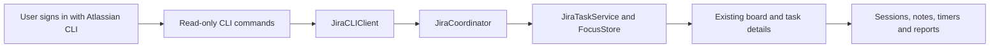

# Jira tasks on the Focus Island board

Status: implemented as an opt-in CLI preview for v0.5.0, 2026-10-23. Original analysis baseline: `c9282f3`; the original proposed design is preserved in commit `2e38acd`.

## Result and implementation decision

The board can import selected assigned Jira Cloud issues into Backlog or Todo, refresh source text/status, and use the existing Claude/Codex sessions, timers, notes, criteria, and reports. Jira status and local progress are independent. This integration never transitions, edits, comments on, or deletes Jira issues.

The initial plan proposed a personal token experiment and left public authentication unresolved. The implementation instead delegates authentication and reads to **Atlassian's official CLI**, installed separately by the user. It uses documented browser OAuth through `acli jira auth login --web`, with no embedded OAuth secret, token-entry form, credential-file reading, hosted broker, or new Swift dependency. This change keeps the app local and provides a distributable client architecture. It is not a certification of Atlassian policy compliance or every tenant's access policies.

[Official CLI authentication](https://developer.atlassian.com/cloud/acli/reference/commands/jira-auth-login/) · [CLI installation](https://developer.atlassian.com/cloud/acli/guides/install-macos/) · [Search command](https://developer.atlassian.com/cloud/acli/reference/commands/jira-workitem-search/) · [Issue read command](https://developer.atlassian.com/cloud/acli/reference/commands/jira-workitem-view/)

## User flow

1. Install ACLI and sign in using its browser flow. Focus Island looks in `/opt/homebrew/bin`, `/usr/local/bin`, and `~/.local/bin`.
2. Settings → Focus → Jira → Connect signed-in account verifies the CLI account, resolves the site's cloud ID, and requires a successful assigned-issue search.
3. Board → Jira → Add from Jira lists assigned, unfinished issues with type, status, project, and priority. Existing imports show “On board”. Select issues, a local destination, and optionally a repository folder.
4. Import fetches selected descriptions and inserts the batch atomically. Backlog is the default; importing never starts focus or a timer.
5. Work with the task as usual. Its issue key opens Jira. Source title/description are read-only while linked; notes and criteria remain local and editable.
6. Refresh linked tasks manually. Reload issues refreshes the discovery list separately. Cached cards work offline. Disconnect cancels pending work, clears the app's connection metadata, and keeps cards/history; it leaves the CLI login alone.
7. Detach explicitly removes a card's Jira link, keeping its current text and local history. Delete uses the existing local task confirmation and cleanup and never deletes the remote issue.

The interface is localized into English, Spanish, and Russian. Issue content remains as written.

## Boundaries and files



| Boundary | Implementation |
| --- | --- |
| [JiraClient](../Sources/FocusCore/JiraClient.swift) | Account verification, cloud-ID lookup, fixed search/view arguments, JSON validation, subprocess timeout/cancellation/output limits |
| [JiraModels](../Sources/FocusCore/JiraModels.swift) | Typed issue data, validated site and identity, bounded plain-text ADF rendering, persisted link |
| [JiraTaskService](../Sources/FocusCore/JiraTaskService.swift) | Atomic selected import, idempotency, refresh, unavailable state, detach |
| [FocusStore](../Sources/FocusCore/FocusStore.swift) | Additive `v7` link table, consistent pre-Jira backup, non-corruption migration failures preserve the database |
| [BoardService](../Sources/FocusCore/BoardService.swift) | Source-field protection on stale editor saves, link snapshots, delete cleanup, shared transaction-scoped insertion |
| [JiraCoordinator](../Sources/OpenIslandApp/Focus/JiraCoordinator.swift) | Serialized asynchronous operations, connection persistence, cancellation, errors and reload callbacks |
| [FocusCoordinator](../Sources/OpenIslandApp/Focus/FocusCoordinator.swift) | Owns the Jira coordinator and refreshes existing board state |
| [JiraImportView](../Sources/OpenIslandApp/Focus/Views/JiraImportView.swift) | Connection/setup UI, picker, folder/destination choice, operation status, issue badge |
| [BoardView](../Sources/OpenIslandApp/Focus/Views/BoardView.swift), [TaskDetailView](../Sources/OpenIslandApp/Focus/Views/TaskDetailView.swift), [FocusSettingsPane](../Sources/OpenIslandApp/Focus/Views/FocusSettingsPane.swift) | Existing user-facing entry points |

Connection metadata (site, email, cloud ID) is stored in UserDefaults; the app stores no authentication secret. Existing `FocusTask` UUIDs and all relationships remain unchanged. `jira_task_links` is keyed by task ID with a unique `(cloudID, issueID)` constraint. Keys can change without creating another task. The side table records remote status/category, assignee ID, remote update time, successful fetch time, and availability. Summary/description stay in the existing task columns, protected from local edits while linked.

## Read and preservation contract

Discovery uses:

```jql
assignee = currentUser() AND statusCategory != Done ORDER BY updated DESC, key ASC
```

The CLI search requests only needed fields with `--paginate --json`. The app validates the complete response before publishing it and rejects incomplete pagination envelopes. Details are read by stable issue ID independently of the discovery query, so completed and reassigned imported issues can still refresh. No local task is removed because it disappeared from search. An unavailable issue keeps its cached text/history; a command failure leaves prior results intact.

The CLI owns HTTP transport, pagination and any HTTP retry behavior. Focus Island bounds each command to 90 seconds and 16 MiB of output, uses private temporary files, discards raw diagnostics, and cancels the process on disconnect. It does not blindly retry failed commands. Requests use explicit argument arrays without a shell; remote content is never executed. The app does not inspect CLI credential files. Before and after each read, CLI account/site must match the saved connection; account changes require reconnection.

ACLI 1.3 exposes human-readable auth status rather than JSON. The adapter accepts the inspected Site/Email labels and fails closed on unfamiliar output. This is a compatibility boundary requiring live acceptance for future CLI versions. Cloud IDs come from Atlassian's documented unauthenticated `/_edge/tenant_info` endpoint. Ordinary HTTPS `*.atlassian.net` sites are supported; custom domains, Government Cloud, and Data Center are not claimed.

A refreshed Jira issue can update source text and the remote badge, but never local column/order, completion time, notes, criteria, prompts, project folder, sessions, activity, or pomodoros. Saving or closing an editor opened before a refresh cannot restore stale source text. Refresh applies only if its original link is still current; late responses cannot undo detach/delete. Disconnect invalidates pending results before database writes.

ADF conversion preserves readable text from common and unknown nodes. It bounds recursion/output, renders plain text, and does not download media or execute HTML. Rich formatting, embedded media, and link annotations may be lost; use the source link for full fidelity. Imported descriptions are never automatically submitted to an agent.

## Migration and recovery

Before migrating an existing `v6` database, save a consistent `before-jira-*.sqlite` snapshot. Reopening an already upgraded database does not create another snapshot. The new table is additive; sessions, task IDs, notes, local progress, timers and reports are retained. Schema/migration errors are no longer treated as proof of corruption. Imports are disabled when the app falls back to in-memory storage.

Prefer disconnecting Jira to downgrading or restoring a backup. A backup restore can discard subsequent local work and is never automatic. The original pre-Codex backup remains available when upgrading older schemas.

## Verification and release gates

Automated coverage is in [JiraTests](../Tests/FocusCoreTests/JiraTests.swift), [JiraCoordinatorTests](../Tests/OpenIslandAppTests/JiraCoordinatorTests.swift), and [SettingsRenderingTests](../Tests/OpenIslandAppTests/SettingsRenderingTests.swift):

- Idempotent batch import, separate sites, invalid batches, issue-key changes, older responses, unavailable issues, detach/delete races.
- Stale editor saves preserve refreshed source text and local notes; session, criterion, prompt, activity, timer and day-plan rows survive refresh unchanged.
- Real on-disk `v6` migration, one consistent backup, preserved records, and migration failure that leaves the original database intact.
- Incomplete/malformed CLI output, host validation, fixed read commands, positive issue-detail decoding, complete-pagination flag, duplicate results, account change, ADF text, process timeout and cancellation.
- Connect/import/restart/disconnect, cancellation of an in-flight import, stale selections rejected before any writes, discovery failure retaining prior data, and disabled imports with in-memory fallback.
- Rendered setup, import and linked-task UI, plus all three localization catalogs.

Validation on 2026-10-23:

- `rtk proxy bin/test.dev` passed: 915 tests reported across 88 suites; the opt-in live Jira check and optional localized settings preview were skipped. Debug app and helpers built successfully.
- `rtk proxy zsh scripts/lint-strings.sh` passed for 982 keys in English, Spanish, and Russian; `rtk git diff --check` passed.
- The Jira setup, import, and linked-task rendering test passed separately with screenshots and text recognition; import and task screenshots were visually inspected.
- Universal package preflight built the app and helpers for Apple Silicon and Intel, verified their architectures and signatures, launched the bundled app outside the repository, and produced DMG/ZIP files. The release script rebuilds these from the final clean `main` commit.
- Independent standards and specification reviews completed; model conformance, stale selection handling, and incomplete pagination findings were corrected and covered by tests.

The opt-in live test runs only when `FOCUS_ISLAND_JIRA_LIVE_EXECUTABLE` points to an authenticated ACLI executable. It imports and refreshes one assigned issue in a disposable in-memory board, retaining a local note and completed column, and performs no Jira writes.

Inspected CLI: **1.3.39-stable**. Its actual help and unauthenticated behavior were checked. The earlier assistant-connected Jira feasibility query returned assigned issues, but that connection is independent of ACLI and does not validate the native path. **Live authenticated ACLI import is not yet certified**; the release is an opt-in preview. All implementation tests use disposable databases and synthetic issue data, never the user's real board or Jira writes.

## Scope retained for later

Automatic polling, custom JQL/filters, simultaneous accounts, workflow mapping/transitions, comments, worklogs, attachments, sprint/board mirroring, custom acceptance-criteria extraction, and native OAuth are deferred. Reassignment is retained as remote assignee metadata; this version does not claim a separate “no longer assigned to me” indicator. Manual refresh and separate Jira/local status are the supported behavior.
