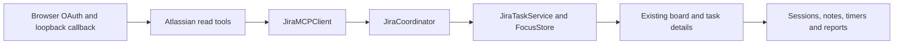

# Jira tasks on the Focus Island board

Status: browser authorization for v0.6.0, 2026-10-23, with manual assignment sync. Original analysis baseline: `c9282f3`; the original proposed design is preserved in commit `2e38acd`.

## Result and implementation decision

The board can import selected assigned Jira Cloud issues into Backlog or Todo, refresh source text/status, and use the existing Claude/Codex sessions, timers, notes, criteria, and reports. Jira status and local progress are independent. This integration never transitions, edits, comments on, or deletes Jira issues.

The v0.6.0 client uses **Atlassian's hosted MCP v2 service** with dynamically registered public-client OAuth, PKCE S256, random state, and a temporary listener bound exclusively to `127.0.0.1`. The browser returns to that listener and the app activates after connecting. No separate CLI, client secret, token entry, Node proxy, or Focus Island server is needed. Requested scopes are `read:me offline_access read:jira:agent-interface search:jira:agent-interface`.

The earlier CLI adapter remains for regression coverage and historical live checks; it is no longer the app's default. Existing linked cards do not need migration. Organization access policy remains enforced by Atlassian; custom callbacks may be blocked, whereas loopback callbacks are documented for native clients.

[Official MCP documentation](https://atlassian.github.io/atlassian-mcp-server/) · [Supported tools](https://support.atlassian.com/atlassian-ai-gateway/docs/supported-tools/) · [Supported callback domains](https://support.atlassian.com/security-and-access-policies/docs/available-atlassian-mcp-server-domains/)

## User flow

1. In Settings → Setup → Jira authorization, Integrate Jira opens the default browser.
2. Approve read/search access. The callback exchanges the code, saves credentials in Keychain, selects a site if needed, and verifies profile/discovery before showing connected state.
3. Sync my Jira tasks, available in Setup and the board’s Jira menu, imports all assigned unfinished issues into Backlog and refreshes existing linked cards. It does not start focus or timers. New imports are fetched before one atomic batch insert; refresh retains cached data on failures. Linked issues missing from discovery are fetched independently, and detach/delete during a pending sync is respected. For selected imports, Board → Jira → Add from Jira lists assigned, unfinished issues with their issue key (including the project key), type, status, and priority. Existing imports show “On board”. Select issues, a local destination, and optionally a repository folder.
4. Import fetches selected descriptions and inserts the batch atomically. Backlog is the default; importing never starts focus or a timer.
5. Work with the task as usual. Its issue key opens Jira. Source title/description are read-only while linked; notes and criteria remain local and editable.
6. Refresh linked tasks manually. Reload issues refreshes the discovery list separately. Cached cards work offline. Disconnect cancels pending work, clears the app's connection metadata and local Keychain credentials, and keeps cards/history. Server-side revocation is available in the user's Atlassian account.
7. Detach explicitly removes a card's Jira link, keeping its current text and local history. Delete uses the existing local task confirmation and cleanup and never deletes the remote issue.

The interface is localized into English, Spanish, and Russian. Issue content remains as written.

## Boundaries and files



| Boundary | Implementation |
| --- | --- |
| [JiraAuthorization](../Sources/FocusCore/JiraAuthorization.swift), [JiraOAuthCallback](../Sources/FocusCore/JiraOAuthCallback.swift) | OAuth discovery, PKCE/state validation, local callback, Keychain and bounded HTTP |
| [JiraMCPClient](../Sources/FocusCore/JiraMCPClient.swift) | Fixed read tools, account/site verification, pagination, token refresh and response validation |
| [JiraModels](../Sources/FocusCore/JiraModels.swift) | Typed issue data, validated site and identity, bounded plain-text ADF rendering, persisted link |
| [JiraTaskService](../Sources/FocusCore/JiraTaskService.swift) | Atomic selected import, idempotency, refresh, unavailable state, detach |
| [FocusStore](../Sources/FocusCore/FocusStore.swift) | Additive `v7` link table, consistent pre-Jira backup, non-corruption migration failures preserve the database |
| [BoardService](../Sources/FocusCore/BoardService.swift) | Source-field protection on stale editor saves, link snapshots, delete cleanup, shared transaction-scoped insertion |
| [JiraCoordinator](../Sources/OpenIslandApp/Focus/JiraCoordinator.swift) | Serialized asynchronous operations, connection persistence, cancellation, errors and reload callbacks |
| [FocusCoordinator](../Sources/OpenIslandApp/Focus/FocusCoordinator.swift) | Owns the Jira coordinator and refreshes existing board state |
| [JiraImportView](../Sources/OpenIslandApp/Focus/Views/JiraImportView.swift) | Connection/setup UI, picker, folder/destination choice, operation status, issue badge |
| [BoardView](../Sources/OpenIslandApp/Focus/Views/BoardView.swift), [TaskDetailView](../Sources/OpenIslandApp/Focus/Views/TaskDetailView.swift), [FocusSettingsPane](../Sources/OpenIslandApp/Focus/Views/FocusSettingsPane.swift) | Existing user-facing entry points |

Connection metadata (site, email, cloud ID) is stored in UserDefaults; OAuth access/refresh tokens and client metadata are stored only in macOS Keychain. Existing `FocusTask` UUIDs and all relationships remain unchanged. `jira_task_links` is keyed by task ID with a unique `(cloudID, issueID)` constraint. Keys can change without creating another task. The side table records remote status/category, assignee ID, remote update time, successful fetch time, and availability. Summary/description stay in the existing task columns, protected from local edits while linked.

## Read and preservation contract

Discovery uses:

```jql
assignee = currentUser() AND statusCategory != Done ORDER BY updated DESC, key ASC
```

Search requests summary/status/type/priority/assignee, paging until completion and rejecting repeated cursors. Detail requests additionally include project, description, and updated time. Discovery accepts missing timestamps; imports/refresh require valid detail timestamps. Both JSON and SSE transport envelopes and Atlassian structured issue nodes are supported. Markdown descriptions become readable local snapshots.

Only `getAccessibleAtlassianResources`, `executeRead` with `getJiraCurrentUser`, `searchJiraIssuesUsingJql`, and `getJiraIssue` are called. HTTPS OAuth endpoints are restricted to Atlassian hosts and redirects are refused. HTTP responses are limited to 16 MiB and 120 seconds. Credentials refresh before expiry; an expired MCP session reinitializes once. Disconnect cancels pending work. No raw credentials or response diagnostics are logged, and no remote content is executed.

A refreshed Jira issue can update source text and the remote badge, but never local column/order, completion time, notes, criteria, prompts, project folder, sessions, activity, or pomodoros. Saving or closing an editor opened before a refresh cannot restore stale source text. Refresh applies only if its original link is still current; late responses cannot undo detach/delete. Disconnect invalidates pending results before database writes.

ADF conversion preserves readable text from common and unknown nodes. It bounds recursion/output, renders plain text, and does not download media or execute HTML. Rich formatting, embedded media, and link annotations may be lost; use the source link for full fidelity. Imported descriptions are never automatically submitted to an agent.

## Migration and recovery

Before migrating an existing `v6` database, save a consistent `before-jira-*.sqlite` snapshot. Reopening an already upgraded database does not create another snapshot. The new table is additive; sessions, task IDs, notes, local progress, timers and reports are retained. Schema/migration errors are no longer treated as proof of corruption. Imports are disabled when the app falls back to in-memory storage.

Prefer disconnecting Jira to downgrading or restoring a backup. A backup restore can discard subsequent local work and is never automatic. The original pre-Codex backup remains available when upgrading older schemas.

## Verification and release gates

Automated coverage is in [JiraTests](../Tests/FocusCoreTests/JiraTests.swift), [JiraCoordinatorTests](../Tests/OpenIslandAppTests/JiraCoordinatorTests.swift), and [SettingsRenderingTests](../Tests/OpenIslandAppTests/SettingsRenderingTests.swift):

- Idempotent batch import, separate sites, invalid batches, issue-key changes, older responses, unavailable issues, detach/delete races.
- Stale editor saves preserve refreshed source text and local notes; session, criterion, prompt, activity, timer and day-plan rows survive refresh unchanged.
- Real on-disk `v6` migration, one consistent backup, preserved records, and migration failure that leaves the original database intact.
- Incomplete/malformed CLI output, host validation, fixed read commands, positive issue-detail decoding, complete-pagination flag, duplicate results, account change, ADF text, process timeout and cancellation.
- Connect/import/restart/disconnect, cancellation of an in-flight import, stale selections rejected before any writes, discovery failure retaining prior data, and disabled imports with in-memory fallback.
- Rendered setup, import and linked-task UI, plus all three localization catalogs.

Initial v0.5.0 validation on 2026-10-23:

- `rtk proxy bin/test.dev` passed: 915 tests reported across 88 suites; the opt-in live Jira check and optional localized settings preview were skipped. Debug app and helpers built successfully.
- `rtk proxy zsh scripts/lint-strings.sh` passed for 982 keys in English, Spanish, and Russian; `rtk git diff --check` passed.
- The Jira setup, import, and linked-task rendering test passed separately with screenshots and text recognition; import and task screenshots were visually inspected.
- Universal package preflight built the app and helpers for Apple Silicon and Intel, verified their architectures and signatures, launched the bundled app outside the repository, and produced DMG/ZIP files. The release script rebuilds these from the final clean `main` commit.
- Independent standards and specification reviews completed; model conformance, stale selection handling, and incomplete pagination findings were corrected and covered by tests.

The opt-in live test runs only when `FOCUS_ISLAND_JIRA_LIVE_EXECUTABLE` points to an authenticated ACLI executable. It imports and refreshes one assigned issue in a disposable in-memory board, retaining a local note and completed column, and performs no Jira writes.

Verified CLI: **1.3.39-stable**. Post-release live testing found that v0.5.0 passed unsupported fields to search. The v0.5.1 regression test reproduces both the rejected arguments and the missing search timestamp; it failed before the fix and passed afterward. It also verifies that incomplete detail snapshots cannot import tasks or change an existing task/link.

The live check passed after the fix: browser-authenticated account verification, cloud-ID lookup, discovery of four assigned issues, detail retrieval by stable numeric ID, one selected import, and refresh preserving a local note and completed column. The issue's Jira status stayed unchanged. The eight client tests, including this live check, passed together. Private issue content and account identifiers are excluded from repository fixtures and logs.

For v0.5.1, `FOCUS_ISLAND_JIRA_LIVE_EXECUTABLE=/tmp/focus-island-jira-tools/acli rtk proxy bin/test.dev` passed with 916 tests reported across 88 suites, including the live check; only the optional localized settings preview was skipped. Localization and whitespace checks passed again. Standards and specification reviews found no remaining issues in the patch.

The integration remains an opt-in preview. Live evidence covers one Jira Cloud account and a small result set, not large-volume pagination, every tenant's policy, or future CLI versions. Fixture tests use synthetic issues; the live test uses a disposable in-memory board and only reads Jira. The user's real Focus Island board is untouched.

For v0.5.2, the full suite passed with 922 tests reported across 88 suites, including both live checks running concurrently; only the optional localized settings preview was skipped. The new live coordinator test syncs all assignments into a disposable board, then repeats sync and verifies card count, local notes, and completion. Fixture tests cover authorization command quoting and launch failures, new-batch failure, cancellation, missing discovery issues, and detach/delete while sync is pending. The first concurrent live run exposed a blocking `Process.waitUntilExit()` cleanup; the stack trace identified the wait after CLI exit. Removing that redundant wait allowed the original concurrent run to complete. Normal exit is already observed asynchronously, and failure cleanup still kills running children.

Setup authorization and connected sync controls passed rendered UI checks and visual inspection. All 986 localization keys passed validation. The supplied `Assets/Brand/icon.png` generated ten transparent macOS icon sizes and the ICNS used by both packaging scripts; aspect ratio and image dimensions were checked. Standards and specification reviews found no remaining issues.

## Scope retained for later

Automatic polling, custom JQL/filters, simultaneous accounts, workflow mapping/transitions, comments, worklogs, attachments, sprint/board mirroring, custom acceptance-criteria extraction are deferred. Reassignment is retained as remote assignee metadata; this version does not claim a separate “no longer assigned to me” indicator. Manual refresh and separate Jira/local status are the supported behavior.

## v0.6.0 verification

Full `bin/test.dev`: 932 tests in 89 suites passed, with the three live Jira checks and optional localized preview skipped. All 1003 localization keys pass. OAuth fixtures cover PKCE/read scopes, exact callback/state, real loopback rejection and cancellation, refresh rotation, pagination, session recovery, and malformed responses. The credential-save/disconnect regression covers serialized teardown.

Rendered Setup/About checks and visual inspection confirm the one-button entry point, version, update controls, and all author credits. A universal package preflight verified Apple Silicon/Intel binaries, embedded Sparkle and nested signatures, and launch outside the checkout. Both review axes are complete; the discovered disconnect race was fixed and rechecked.

Live browser authorization is blocked as of October 23, 2026: the disposable app reaches an enabled Read/Search consent page, but Accept produces Atlassian's `invalid_request / Incorrect request parameters` before the loopback callback. Explicit consent and native-client registration retries both reproduced the error. The new browser flow has not imported live issues; earlier CLI results above do not validate it. The signed-in account could not access the organization's effective MCP settings, and no policies were changed.

The current request follows the discovered authorization server, exact registered callback, PKCE S256, public-client authentication, and advertised read/search scopes. [Atlassian's consent troubleshooting](https://support.atlassian.com/rovo/kb/fix-oauth-consent-block-for-atlassian-rovo-mcp-server-in-atlassian-cloud/) identifies organization callback policy as a possible cause. [An independent SDK report](https://community.developer.atlassian.com/t/rovo-mcp-oauth-returns-invalid-request-after-consent-reproduced-with-independent-python-mcp-sdk-client/103197) describes the same failure. Neither establishes this account's root cause; an organization-policy check or provider-side trace is required before more speculative client changes.

Official Sparkle tools verified the signed feed and archive and rejected a tampered feed. A disposable host also detected a newer version, recognized the current version, and rejected the tampered feed. Update installation/relaunch remains untested. Release publication is held pending successful browser authorization and disposable-board sync.
