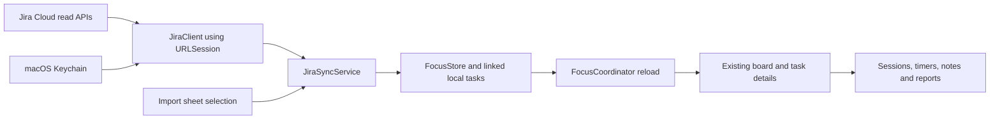

# Jira tasks on the Focus Island board

Status: proposed; no integration implemented. Analysis date: 2026-10-23. Source baseline: `main` at `c9282f3`.

## Recommendation

Add a **read-only Jira Cloud import with refresh**. The user connects their account, browses their assigned issues, selects the ones they want to work on, and adds them to the existing board. Imported tasks use the existing Claude/Codex session binding, timers, notes, criteria, and reports.

Jira owns the issue summary, description, and remote status. Focus Island owns the personal work column, ordering, project folder, notes, criteria, sessions, and time. Moving a card or closing a focus task never transitions the Jira issue. A separate Jira status badge makes that distinction visible.

Start with one site and one account, selected imports, and manual refresh. A personal pilot can evaluate scoped API-token authentication; a public release needs an approved distribution/authentication path first. See [API and authentication research](JIRA-API-RESEARCH.md). The existing connected Jira tool proves that the account can read assigned issues, but its authorization does not provide credentials or an API for the standalone macOS app.

## What was verified

- Source review confirmed a native SwiftUI/AppKit app with GRDB/SQLite storage and no existing Jira client, HTTP authentication flow, or Keychain credential store in `Sources/`.
- A read-only query against the connected Jira Cloud account returned four open assigned issues, including Task, Story, and Epic types, with In Progress, To Do, and a custom Submitted status. The result was one complete page. No descriptions, comments, or attachments were needed for this analysis.
- The live query was `assignee = currentUser() AND statusCategory != Done ORDER BY updated DESC`. It includes all assigned issue types; the UI should say “issues” and display type rather than silently treating an Epic as an ordinary task or excluding it.
- Private issue titles, account identifiers, tenant identifiers, and API payloads are deliberately omitted from these public repository notes. Live results establish feasibility at the analysis date, not a permanent issue count or proof of native authentication.

| Existing boundary | Current behavior | Integration consequence |
| --- | --- | --- |
| [FocusModels](../Sources/FocusCore/FocusModels.swift), `FocusTask` | Local UUID, title/details, column, position, project path, note, timestamps | Keep local UUIDs and relationships; add Jira identity in a side table |
| [BoardService](../Sources/FocusCore/BoardService.swift) | Creates, edits, reorders, deletes, and binds tasks | Reuse insertion rules and transactions; guard source-owned fields for linked tasks |
| `BoardService.bindSession` | Binding a Backlog/Todo task moves it to In progress | Local progress must not be coupled to Jira transitions |
| [FocusStore](../Sources/FocusCore/FocusStore.swift) | Schema currently ends at `v6`; on-disk recovery and pre-Codex backup | Add an additive migration and a Jira-specific backup gate |
| [FocusCoordinator](../Sources/OpenIslandApp/Focus/FocusCoordinator.swift) | Main-actor state, board reload, one-second focus tick, close/undo and timer effects | Publish import results here; keep networking out of the focus tick |
| [BoardView](../Sources/OpenIslandApp/Focus/Views/BoardView.swift) | Four columns, project-path filter, seven-day completed-task visibility | Add import/refresh actions and Jira badge; retain filters and local archive behavior |
| [TaskDetailView](../Sources/OpenIslandApp/Focus/Views/TaskDetailView.swift) | Editable state copy of a task; Save and Close both persist edits | Prevent a stale open editor from overwriting refreshed Jira fields |
| [NextActionEngine](../Sources/FocusCore/NextActionEngine.swift) | Suggests Todo tasks, prioritizing the local project path | A Jira project is not a filesystem folder; let the user choose a folder |
| [FocusSettings](../Sources/FocusCore/FocusSettings.swift), [SettingsView](../Sources/OpenIslandApp/Views/SettingsView.swift) | Local preferences; Settings already has a Focus pane | Add a Jira section to Focus settings without changing hook setup |

## First-release user flow

1. **Connect:** Settings → Focus → Jira. Show the verified account/site and connection state. The personal-pilot token setup is separate from any future public OAuth flow.
2. **Browse:** Board → Add from Jira opens a sheet showing assigned, non-Done issues with key, summary, issue type, status, project, and priority. Search within fetched results; load all pages before describing the list as complete. Previously imported issues show “On board” and open the existing card.
3. **Choose:** Select one or more issues. Default destination is **Backlog**, with an optional Todo choice. Let the user assign a local project folder or leave it unset. Do not infer a repository path from a Jira project key. Imported In Progress issues still enter the chosen local column, so importing cannot steal current focus.
4. **Work:** The resulting card behaves like any other Focus Island task: move to Todo, Start, bind Claude/Codex sessions, run focus timers, add local criteria and notes, and close/undo. Show the issue key, Jira status, and “Open in Jira”.
5. **Refresh:** A manual board action refreshes linked issue metadata; the import sheet refreshes its discovery query independently. Show last successful refresh, progress, and actionable errors. Cached cards remain usable offline.
6. **Disconnect:** Cancel requests, remove the Keychain secret, and stop refresh. Keep imported cards, cached issue text, and local work history. Same-account reconnection reuses existing links. Explain retained data; never delete tasks as a side effect of disconnecting.

All new interface text follows the existing English, Spanish, and Russian localization conventions. Issue content remains in its original language. Provide keyboard selection, accessible button labels, and a non-color status label.

## Ownership and lifecycle rules

| Data/action | Owner and required behavior |
| --- | --- |
| Issue ID, key, URL, summary, description, project, type, priority, status/category, assignee, Jira update time | Jira. Refresh the cached values without changing local workflow |
| Task ID, column, position, note, criteria, queued prompts, project path, sessions, activity, pomodoros, local completion time | Focus Island. Never replace from a Jira response |
| Title/details editor | Read-only while linked; “Open in Jira” edits the source. Local notes and criteria remain editable |
| Local Done / Undo | Changes only the existing local lifecycle and reports; display Jira status separately |
| Jira Done / reopened | Refresh the badge; retain the local column, timer, and completion history |
| Reassigned or excluded by discovery filter | Keep the card. Refresh it directly by issue ID; mark no longer assigned when the returned assignee proves it |
| Missing from search | No deletion or inferred completion. Absence may reflect filtering, indexing, or permission changes |
| Issue returns 403/404 | Keep last known metadata and local history; label unavailable. Do not claim “deleted” or disclose inaccessible new data |
| Same issue imported again | Select/open the existing local task; uniqueness holds across reconnects and concurrent clicks |
| Detach from Jira | Explicit action retains the last title/details and all local work; removes the source link and makes text editable |
| Delete local task | Existing confirmation and cleanup apply, including the Jira link. Never delete the Jira issue. It can be explicitly imported again later |

Detach is intentionally different from disconnect: disconnect preserves source identity for reconnection; detach makes an independent local task. A later explicit import after detaching can create a new linked task. No automatic import loop should recreate deleted or detached cards.

Do not derive board columns from status names. Even Jira status categories cannot distinguish Focus Island Backlog from Todo. This release needs no workflow mapping configuration.

## Architecture and storage



Keep the five existing production targets. Use Foundation `URLSession`, Security.framework, and existing GRDB; no new package, daemon, webhook server, MCP client, or generic issue-provider framework is required for the personal pilot.

Proposed additions:

- `Sources/FocusCore/JiraModels.swift`: small Codable/Sendable response and link models. Decode only used fields; handle null description/priority/assignee and unknown status categories.
- `Sources/FocusCore/JiraClient.swift`: async Jira Cloud reads with injectable transport, explicit endpoint allowlist, pagination, decoding, cancellation, and bounded retry.
- `Sources/FocusCore/JiraSyncService.swift`: selected import, linked refresh, source-field ownership, and transactions using `FocusStore`. No AppKit or network request inside a database transaction.
- `Sources/OpenIslandApp/Focus/JiraCredentialStore.swift`: Keychain operations behind the smallest injectable credential interface needed by tests.
- `Sources/OpenIslandApp/Focus/Views/JiraImportView.swift` and `JiraSettingsSection.swift`: import and connection UI. `FocusCoordinator` owns operation state and publishes completed changes through its existing reload path.

Add migration `v7` if it remains the next unused version at implementation time:

| Table | Minimum stored data and constraints |
| --- | --- |
| `jira_connections` | ID, cloud ID, canonical site URL, account ID, account display label, Keychain item reference, disconnected state, last attempted/successful refresh. Reconnect the same `(cloudId, accountId)` row. Support only one active connection initially |
| `jira_task_links` | `taskId` primary/foreign key with deletion cleanup; connection ID; cloud ID; stable issue ID; current issue key; project key/name; issue type; priority; status name/category; nullable assignee ID; remote updated time; last successful fetch; availability/error state. Unique `(cloudId, issueId)` prevents reconnect duplicates |

Store synchronized summary/description in the existing `tasks.title`/`details`; the link identifies their ownership. Keep `FocusTask.id` as a local UUID. A changed issue key updates the link and browser URL without re-identifying the task. Build browser links from the trusted site URL and encoded key. Explicit account/site changes must not silently reassign existing links to another identity; leave old cards disconnected until the user explicitly reconnects or detaches them.

Keep source timestamps separate from local timestamps. A metadata refresh may update `tasks.updatedAt` when text changes, but must not alter `createdAt`, `doneAt`, ordering, or any work records. Include link metadata in the board snapshot/read so card rendering does not make one database query or network request per card.

`BoardService.insertTask` is currently private. Expose only the transaction-scoped insertion helper needed to create a task and link atomically, preserving title validation and end-of-column positioning. Avoid calling the public write method from inside another GRDB write transaction. `BoardService.updateTask` must enforce linked title/details ownership at the service boundary, including the Save and Close callers. Display current source text from the refreshed model while preserving unsaved local note edits.

Before `v7`, create a consistent `before-jira-*.sqlite` backup only for an existing database that has not applied that migration. The current pre-Codex `v6` check does not protect a `v6` → `v7` upgrade. Migration failures must preserve the original database and must not be misclassified as corruption. Disable importing while `FocusStore` is in its in-memory fallback so the UI cannot promise durable imports. Do not automatically restore a backup over newer work; disabling Jira preserves current local data and is the preferred recovery action.

## Fetch and refresh contract

Use Jira Cloud REST API v3 enhanced search, `POST /rest/api/3/search/jql`, rather than the retired search endpoints. The exact host prefix depends on authentication; scoped API tokens use the Atlassian API gateway. The [research notes](JIRA-API-RESEARCH.md) contain official endpoint and authentication references.

Default discovery JQL:

```jql
assignee = currentUser() AND statusCategory != Done ORDER BY updated DESC, key ASC
```

The live feasibility check used only `updated DESC`; the added key tie-breaker is a proposed deterministic ordering, to verify in the native-client spike. Do not replace `currentUser()` with an email. Initial scope is fixed JQL across accessible projects; custom JQL, saved filters, and Jira boards/sprints can follow demonstrated need.

1. Validate credentials using the identity endpoint; verify the selected site and query permissions. Request only fields needed for the list: `summary`, `status`, `project`, `issuetype`, `priority`, `assignee`, and `updated`. Fetch `description` for selected or already-linked issues.
2. Follow opaque `nextPageToken` values until completion; do not assume the requested page size is honored or use old `startAt` pagination. Deduplicate results by stable issue ID. A failed or cancelled page leaves the discovery list visibly incomplete and does not invalidate existing cards. Repeated/invalid tokens fail clearly instead of looping forever.
3. Fetch selected issue details, validate and normalize them, then commit each selected batch of tasks and links in one short GRDB transaction. Report success only after durable commit. If any selected issue is unavailable, identify it and let the user retry or deselect it before import; never silently drop a selected issue.
4. Refresh linked issues directly by ID, independently of the discovery filter. For a small personal board, a serial cancellable GET per linked issue is sufficient; do not add a batch scheduler prematurely. Commit successful issue updates independently and report partial refresh accurately. Keep per-issue freshness and do not mark a full refresh successful if some fetches failed.
5. Serialize refresh/import operations for a connection. Capture an operation generation; a disconnect, token replacement, account change, or cancellation invalidates late responses before they can write. Within the write transaction, re-check the task/link still exists so a response cannot undo a local delete or detach. Reject older remote snapshots.
6. Honor HTTP 429 and `Retry-After`, with bounded backoff/jitter for transient failures. Surface 401 as reconnect required, 403 as permission/scope trouble, 400 as a query/configuration error, and 404 as unavailable. A system-wide 403 must not mark every issue deleted. Preserve cached content on all failures.

Jira v3 descriptions are Atlassian Document Format (ADF), not Markdown strings. Convert a bounded subset to readable plain text for the existing details UI: paragraphs, headings, lists, text, links, and code blocks. Preserve readable text from unknown nodes and show a fallback notice plus “Open in Jira” when fidelity is limited. Do not fetch embedded media or attachments, run HTML/JavaScript, execute content instructions, or automatically send descriptions into an agent session. This is task content, not a new instruction channel.

Manual refresh is the acceptance baseline. Optional refresh on launch/foreground and every five minutes while awake can follow once retry, cancellation, and stale-response tests pass. It uses a separate task and pauses offline/asleep/disconnected; no Jira call runs from the existing one-second focus tick.

## Authentication and release boundary

For the user's own pilot, validate a scoped Jira API token with only the read capabilities required by identity, search, and issue reads. Store it in macOS Keychain, never UserDefaults, SQLite, command-line arguments, fixtures, or logs. Non-secret connection metadata can live in SQLite. Do not read another application's credential storage or try to reuse the connected assistant's session.

For this experiment, the setup needs the Jira site, account email, and scoped token; discover the cloud ID using Atlassian's documented site lookup and confirm identity with `/myself`. Use email/token Basic authentication at `https://api.atlassian.com/ex/jira/{cloudId}`. The API reference recommends classic scopes `read:jira-work` for search/issue reads and `read:jira-user` for identity; verify the equivalent scope choices actually offered by the token UI before documenting setup. No write scope is required. See the [endpoint/scope matrix and Cloud-ID reference](JIRA-API-RESEARCH.md).

Validate HTTPS hosts and paths before attaching authorization, reject credential-bearing URLs, and prevent cross-origin redirects from forwarding credentials. Sanitize diagnostic errors. Treat source links as untrusted until checked against the configured site; user-activated issue links open in the system browser.

The repository distributes a public macOS app. Atlassian's current guidance warns against distributed apps collecting customers' API tokens or asking each customer to create their own 3LO application. A personal-token prototype must therefore remain a personal development experiment, excluded from public release artifacts pending an approved route. Document the build/release gate rather than presenting token entry as the finished public Connect flow.

Public OAuth is an implementation gate, not a promised native-only feature: verify current Atlassian support for native/public clients, PKCE, callback registration, secret handling, and distribution approval. Never bundle a confidential OAuth client secret in a desktop binary. If a supported flow requires a hosted token service, that conflicts with the current local-first/no-server constraint and requires a product decision before broad rollout. This plan does not silently introduce that service.

Token expiry/revocation and account scope policies must be tested with the actual tenant. Keychain access must also be checked with development and packaged app signing: the current release is ad-hoc signed, so durable access across app replacement cannot be assumed from a unit test.

## Implementation sequence and acceptance gates

| Step | Work | Exit gate |
| --- | --- | --- |
| 1. Authentication/API spike | Verify personal scoped token, identity, canonical site/cloud ID, exact read scopes, enhanced search, two pages, direct issue read, and one ADF sample using disposable/sanitized fixtures | Native-client reads work; endpoint/scope matrix recorded; personal/public authentication boundary settled before packaging |
| 2. Storage and import | Add migration, backup handling, Jira link records, uniqueness, transactional insertion, detach/delete cleanup, source-field protection | Existing `v6` data survives; import/reimport/reconnect creates one task; no orphan links or lost local work |
| 3. Complete manual UI slice | Jira settings section, picker, optional folder/destination choice, card badge, task source text/link, manual refresh, disconnect | User can select an assigned issue, work on it with Claude and Codex, restart offline, and recover the same card/history |
| 4. Refresh hardening | Pagination failures, unavailable/reassigned/Done issues, cancellation, Keychain failures, retries, stale open editors, account changes | Failure scenarios preserve board state; no unexpected Jira writes or stale-response resurrection |
| 5. Release decision | Optional periodic refresh; localization/accessibility; README support matrix and authentication instructions; packaged manual verification | Pilot acceptance recorded; public packaging only after the authentication distribution gate passes |

Use small vertical changes. Do not start with a provider framework, a Jira kanban clone, a two-way sync engine, or a hosted service. An implementation estimate should follow step 1; authentication feasibility is the main uncertainty, while local board reuse is already supported by source review.

## Verification plan

Extend existing Swift Testing targets using in-memory GRDB and a deterministic HTTP transport/`URLProtocol` stub; ordinary tests never call live Jira or require credentials.

- **Migration/preservation:** populated `v6` fixture → next schema, backup consistency and failure paths, repeated launch, old local tasks, linked Claude/Codex sessions, activity, criteria, prompts, pomodoros, day plans, and done timestamps unchanged. Verify real on-disk migration, not only an in-memory fresh schema.
- **Import identity:** repeated and simultaneous import, renamed issue key, reconnect, same issue ID on different sites, account switch, empty summary, null fields, batch rollback, deleting/detaching during a request, and disk-full/write failure.
- **Remote/local independence:** dragging, binding sessions, Close/Undo, Jira Done/reopen, reassignment, and filter changes preserve the correct side's ownership. Assert the transport never calls transition/edit/comment/worklog/delete APIs.
- **Refresh/editor races:** open a task, edit the local note, refresh a changed Jira summary/description, then Save and Close. Neither operation restores stale source text or loses the note. A delayed response after disconnect/detach/delete cannot recreate a link or task.
- **HTTP/format:** multiple pages, duplicate results, repeated token, middle-page failure, 400/401/403/404/429/5xx, timeout, offline, cancellation, invalid JSON, bounded ADF traversal, Unicode, unsupported nodes, sanitized diagnostics, and rejected off-host redirects.
- **UI/manual:** clear source status vs local column, import into Backlog without starting focus, folder choice, all three languages, keyboard/VoiceOver, partial refresh, reconnect, app restart, and packaged Keychain persistence. Use a disposable board database for automation; do not mutate the user's real board for tests.

At implementation time run the repository's existing checks through RTK:

```bash
rtk proxy bin/test.dev
rtk proxy zsh scripts/lint-strings.sh
rtk git diff --check
```

Manual acceptance: connect the user's own read-capable account; select one issue; import; bind a Claude/Codex session; record local focus work; close and undo locally; verify Jira status is unchanged; refresh remote text; restart offline; disconnect and confirm all local work remains. Any source-side change needed for a live test should use an explicitly authorized disposable Jira issue. Synthetic tests cover these cases otherwise.

## Deferred scope and current validation limits

Two-way transitions, issue creation/editing, comments, worklogs, attachment download, sprint/board mirroring, automatic import of every assignment, multiple simultaneous accounts, custom-field/acceptance-criteria mapping, Jira Data Center, and a general integration platform are outside this first slice.

This change contains analysis and planning documents only. Verified: repository behavior by source, connected-account discovery query, and current primary-source API documentation. Not verified: app-native Jira authentication, actual token scopes, Keychain behavior, runtime import/sync, migration, packaged UI, or tests for an implementation that does not yet exist.

Planning-artifact checks: 13 relative documentation links resolved; fenced blocks and JSON examples checked; sampled private Jira identifiers absent; staged diff whitespace check passed. No application build or test suite was needed for these documentation-only changes.
